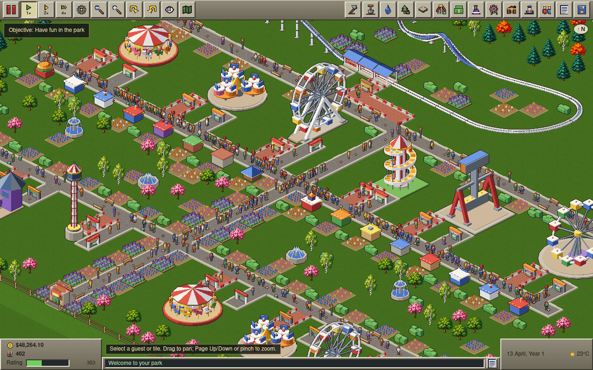
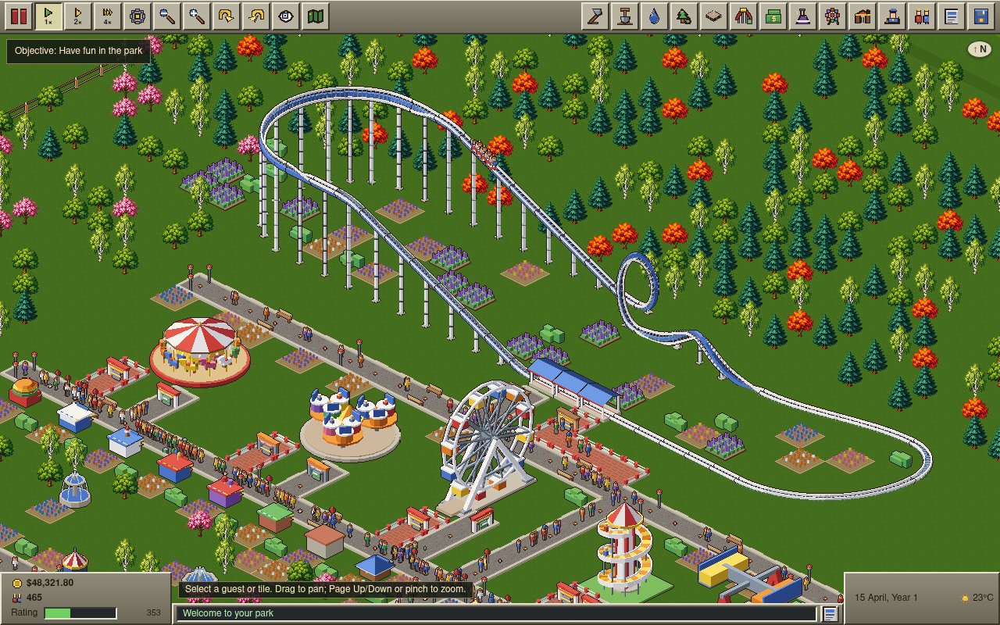
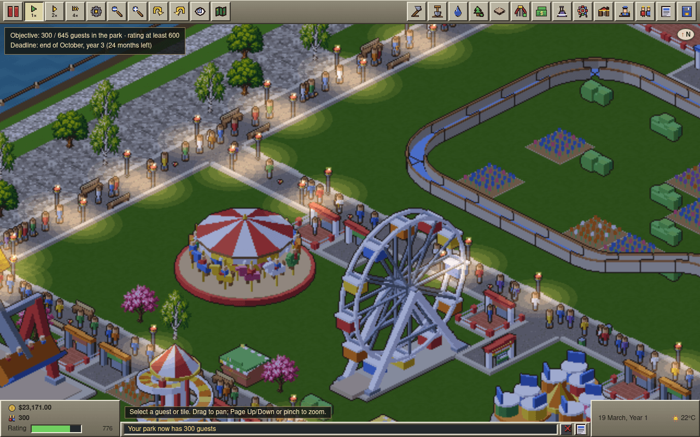

# OpenCoaster

**Build roller coasters, run a theme park, and keep your guests happy, right in your browser.**

OpenCoaster is an open-source, clean-room theme-park management game inspired by the gameplay of 1999–2004 era roller-coaster tycoon games. Lay out paths, build coasters with lift hills, loops and corkscrews, hire staff, set prices and watch thousands of simulated guests decide whether your park is worth the ticket.

### [▶ Play now at opencoaster.noriagentic.com](https://opencoaster.noriagentic.com/)

No install, no account. It runs on desktop and on phones, and works offline once loaded.



|                                                                                                                                                                                                |                                                                                                                                                                                                |
| ---------------------------------------------------------------------------------------------------------------------------------------------------------------------------------------------- | ---------------------------------------------------------------------------------------------------------------------------------------------------------------------------------------------- |
|  |  |
| A steel looping coaster: lift hill, drop, vertical loop and corkscrew.                                                                                                                         | Riverside Fairground at dusk, with the path lamps lit.                                                                                                                                         |

## What you can do

- **Design coasters piece by piece.** Stations, flat track, 25° and 60° slopes, small to large curves (flat, banked and sloped), vertical loops, corkscrews, S-bends, helices, tunnels, chain lifts, brakes, block brakes and launch sections. Each finished circuit gets a test run that measures speed, G-forces, drops, inversions and airtime to produce excitement, intensity and nausea ratings.
- **Run 19 rides and 13 stalls and facilities.** Wooden, Steel Looping, Junior and Wild Mouse coasters; a log flume and river rapids; a miniature railway, monorail and chairlift; flat rides from the Merry-Go-Round and Ferris Wheel to the Top Spin and Enterprise; food, drink, souvenir and balloon stalls, information kiosks and toilets. Stalls rotate to face the path and sell items guests carry around the park.
- **Watch guests think for themselves.** Every guest tracks hunger, thirst, toilet needs, energy, nausea and happiness, has a thrill preference and a budget, judges ride and ticket prices, queues single file, sits on benches, drops litter and tells you what they think.
- **Hire and manage staff.** Handymen sweep, mow, water and empty bins; mechanics inspect and repair rides as they wear down and break; security guards deter vandals; entertainers cheer guests up. Assign patrol areas and work orders.
- **Shape the land.** Raise, lower, flatten and smooth terrain, raise and lower water, buy land and construction rights, lay footpaths, queues, ramps and raised bridges, and decorate with trees, flower beds, fountains, statues, fences, benches, bins and lamps.
- **Balance the books.** Choose an entry fee or pay-per-ride, take and repay loans, fund research to unlock new ride types, and run marketing campaigns. Finance windows chart cash, park value and weekly profit, and your park can win (or lose) awards.
- **Play scenarios or a sandbox.** Eleven original scenarios from beginner to expert, each with its own map, climate and goal (guests, park rating, park value, ride income, food profit, or excellent coasters), plus an unrestricted sandbox.
- **Live with the weather.** Sun, cloud, rain and storms change what guests want to do, and the park shifts from day to night with lamps that light up after dusk.
- **Save anywhere.** Save to in-browser slots, or export and import `.ocsave` files.

Everything runs locally: the simulation is deterministic and runs in a Web Worker, the world draws with WebGL2 (with a Canvas2D fallback), and all art, music and sound effects are original or procedurally generated.

### What's not there yet

OpenCoaster is a playable game, not a finished remake. The ride catalog is smaller than the games that inspired it, research unlocks rides but not scenery, there are four weather types rather than a full forecast system, and some rating and guest-behaviour formulas are still being tuned. Open gaps are tracked in [docs/mechanics/gap-audit.md](docs/mechanics/gap-audit.md) and [docs/fidelity/](docs/fidelity/).

## Built with Nori Projects

OpenCoaster was built by AI coding agents running on [Nori](https://noriagentic.com), working as one Nori Project with people steering along the way.

- **It started as a goal.** The owner gave the project one goal: an efficient, open-source browser game in the spirit of the classic coaster tycoon games, built by researching how each game mechanic works, parallelizing aggressively, and alternating between Claude and ChatGPT models.
- **A coordinator broke it up.** A persistent project coordinator kept the goal and shared context, split the work into mechanics research and implementation tasks, and handed each one to its own cloud subworker.
- **Many agents worked in parallel.** Subworkers ran side by side on separate branches, mixing Anthropic Claude and OpenAI Codex models. Mechanics research was written up with public sources in [docs/mechanics/](docs/mechanics/) before code was written against it.
- **Work was checked, not just merged.** Each change came in as a pull request with tests, and UI and art changes carried browser screenshots that were reviewed before merging. Proof captures live on the repository's `nori/pr-proofs` branch.
- **Playtests fed back into the work.** Agents played the live build through a real browser and wrote up what broke (see [docs/playtest/](docs/playtest/)). The owner played builds too and sent feedback, such as lamps that turn on after dark, queue lines that stay single file, and harder scenarios with awkward terrain, and the coordinator turned that feedback into new tasks.

The commit history, pull requests and [docs/DECISIONS.md](docs/DECISIONS.md) record how the game came together.

## Run it locally

You need Node.js 20 or newer and pnpm 10 (`corepack enable` provides the pinned version).

```sh
git clone https://github.com/tilework-tech/opencoaster.git
cd opencoaster
pnpm install
pnpm dev       # Vite dev server at http://localhost:5173
```

The first `pnpm dev` or `pnpm build` generates the sprite pages from the art sources, which takes a few minutes.

Checks:

```sh
pnpm check     # lint, format, typecheck, unit tests and production build (what CI runs)
pnpm e2e:quick # desktop Playwright subset for UI changes
pnpm e2e       # full Playwright suite, desktop and Pixel 8
pnpm bench     # simulation benchmark
```

Pushes to `main` deploy to GitHub Pages at [opencoaster.noriagentic.com](https://opencoaster.noriagentic.com/) ([docs/deploy/README.md](docs/deploy/README.md)).

## Contributing

Contributions are welcome. Please read [CONTRIBUTING.md](CONTRIBUTING.md) first: the clean-room rules are mandatory, so never use original game assets, decompiled code or code from incompatibly licensed projects. Then see [AGENTS.md](AGENTS.md) for commands and conventions and [docs/ARCHITECTURE.md](docs/ARCHITECTURE.md) for how the simulation, worker and renderers fit together.

## License

[MIT](LICENSE). This clean-room project is not affiliated with or endorsed by the publishers of any commercial game, and contains none of their assets or code. All art and audio are original or procedurally generated.
