# OpenCoaster live fidelity audit — October 2026

## Scope and method

**Target:** published OpenCoaster build at https://tilework-tech.github.io/opencoaster/
**Source revision inspected:** repository `04dcf7d8592da91be7064ff0ac72dc4c0bd9b927` (`main`)
**Browser coverage:** headed Chromium via Playwright/CDP, desktop 1280×800 and Pixel 8 emulation at 412×915, DPR 2.625. The Pixel profile is Chromium emulation, not a physical phone or Safari.
**Scenario:** Starter Park, with an objective of 100 guests and rating 450 by the end of Year 1. Played at 4×. This audit records the UI and behavior observed in this build; a full-year outcome is recorded below after the deadline is reached.

The RCT2 column describes the expected equivalent in words. No original RCT2 screenshots, sprites, sound, or game data are copied into this repository. Evidence images below are captured from OpenCoaster. The scenario was started, staff hired, a path, Merry-Go-Round, Food Stall, and closed-loop Steel Looping Coaster built, a loan increased, marketing run, and a save slot loaded. The scenario ran without an observed page crash. Browser error listeners reported no console or page errors during the recorded interactions; this is not a claim about unobserved sessions.

The RCT2 manual is the primary player-facing reference. OpenRCT2 docs are used as secondary behavior and interface corroboration; they are not proof that every compatibility detail matches the original executable. Public video references provide visual/gameplay context only.

## Screenshots and RCT2 equivalents

| OpenCoaster evidence                                                                                                                                                        | RCT2 equivalent described by public references                                                                                                                                                                                                                                                                                                                                                                                                                                                                                                                                        |
| --------------------------------------------------------------------------------------------------------------------------------------------------------------------------- | ------------------------------------------------------------------------------------------------------------------------------------------------------------------------------------------------------------------------------------------------------------------------------------------------------------------------------------------------------------------------------------------------------------------------------------------------------------------------------------------------------------------------------------------------------------------------------------- |
| 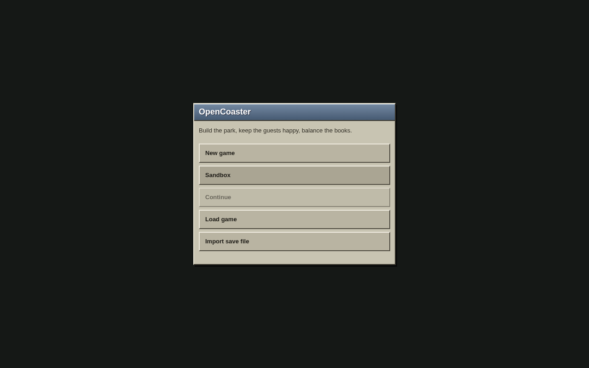                                                                                             | The RCT2 main menu offers New Game, Load Game, tutorial/tools and exit. New Game proceeds to scenario selection. The manual shows the classic game menu and scenario flow (pp. 10–13). [RCT2 manual](https://cdn.akamai.steamstatic.com/steam/apps/285330/manuals/manual.pdf)                                                                                                                                                                                                                                                                                                         |
| 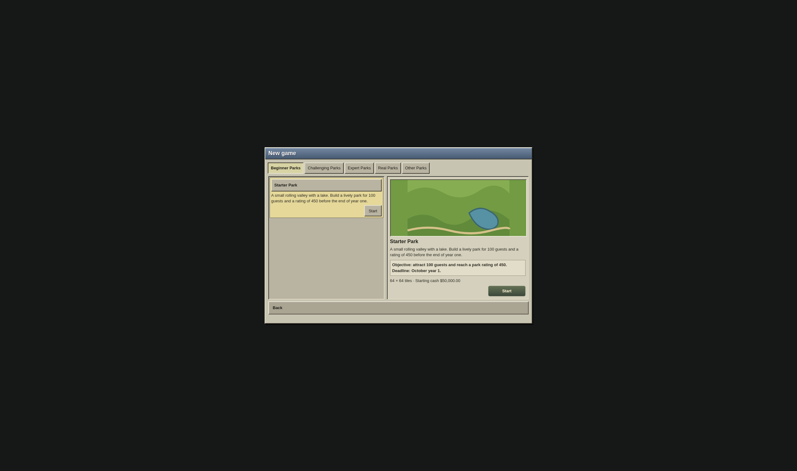                                                                                    | RCT2 scenario selection uses Beginner, Challenging, Expert, Real and Other categories. Selecting a park presents its description and objective. Starter Park's objective here is displayed as 100 guests and rating 450 by October year 1. [RCT2 manual](https://cdn.akamai.steamstatic.com/steam/apps/285330/manuals/manual.pdf)                                                                                                                                                                                                                                                     |
| 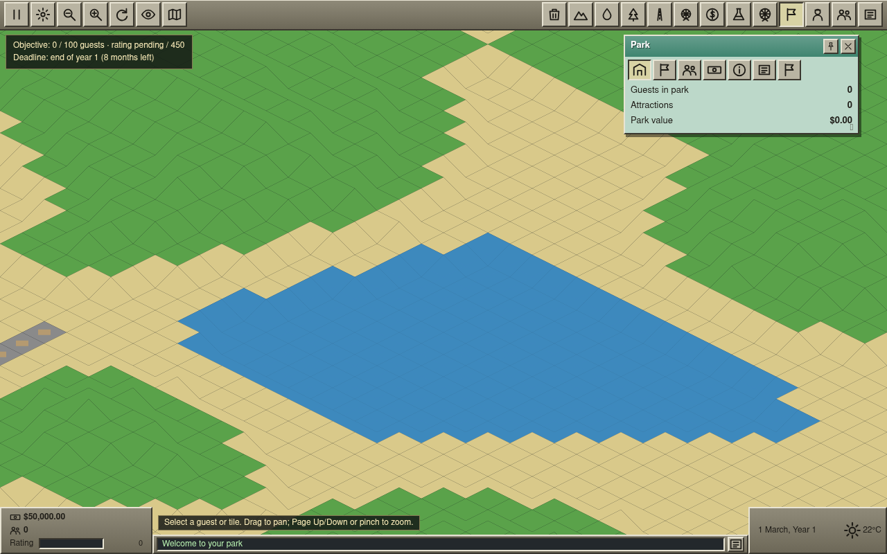                                                                                                        | RCT2 keeps the isometric park in the background, with a top toolbar, lower-left cash/guest/rating block, lower-right date/weather block, message area and overlapping draggable windows. OpenCoaster now has those main status surfaces, but its art, icon groupings, spacing and park window hierarchy remain different. [Manual UI sections](https://cdn.akamai.steamstatic.com/steam/apps/285330/manuals/manual.pdf), [OpenRCT2 main interface](https://docs.openrct2.io/en/latest/playing/main_interface/)                                                                        |
| 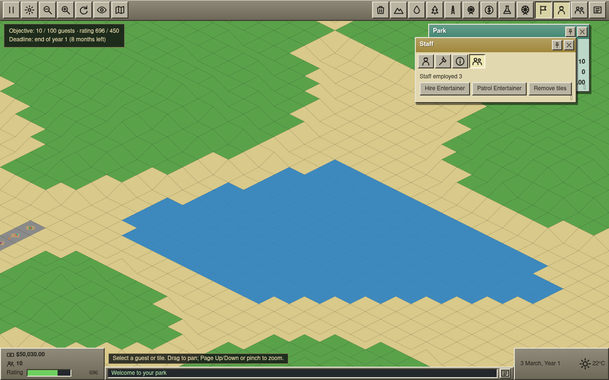                                                                                  | The RCT2 Staff window hires Handymen, Mechanics, Security Guards and Entertainers; individual workers expose orders, patrol, rename, locate and sack controls. The audit hired a Handyman, Mechanic and Security Guard; staffing controls work, while detailed role behavior and worker-window parity were not fully exercised. [RCT2 manual, pp. 41–43](https://cdn.akamai.steamstatic.com/steam/apps/285330/manuals/manual.pdf)                                                                                                                                                     |
| 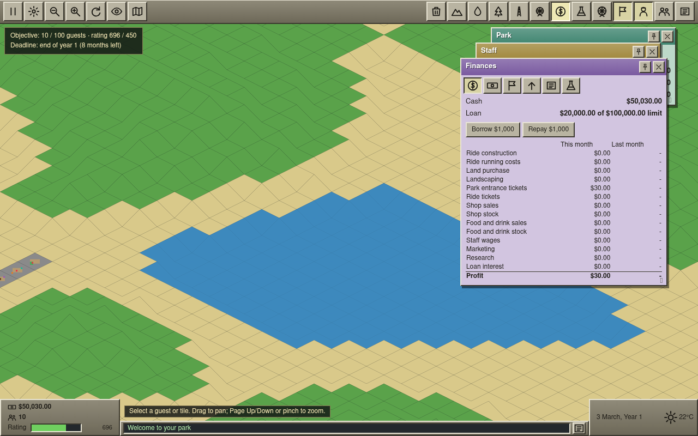                                                                                         | RCT2's Finance window has accounts, cash graph, park-value graph, weekly-profit graph, marketing and research tabs. The account view shows categorized monthly income/expenses and loan controls. OpenCoaster's live build has these six tabs and its $1,000 Borrow action changed the loan from $20,000 to $21,000. Exact interest and accounting parity are separate questions. [Manual, pp. 48–51](https://cdn.akamai.steamstatic.com/steam/apps/285330/manuals/manual.pdf), [OpenRCT2 finances](https://docs.openrct2.io/en/latest/playing/finances/)                             |
| 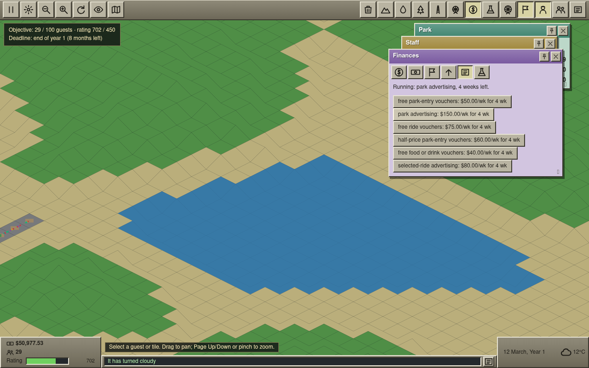                                                                                  | RCT2 presents six campaign families with a duration choice and weekly cost; campaigns can promote the park, a ride, or a specific offer. Park advertising started in the live build and appeared as a four-week campaign at $150/week. [RCT2 manual, pp. 48–50](https://cdn.akamai.steamstatic.com/steam/apps/285330/manuals/manual.pdf)                                                                                                                                                                                                                                              |
| 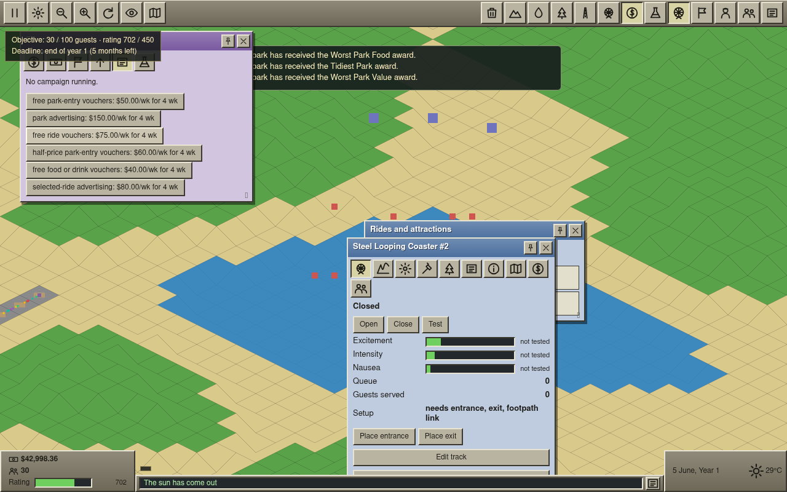                                                                                 | A ride voucher or selected-ride campaign in RCT2 is tied to a ride; a food/drink voucher is tied to an item. In OpenCoaster, clicking “free ride vouchers” with no target left the UI at “No campaign running.” The UI offers no target or duration chooser. See P0-1 below. [RCT2 manual, pp. 48–50](https://cdn.akamai.steamstatic.com/steam/apps/285330/manuals/manual.pdf)                                                                                                                                                                                                        |
| 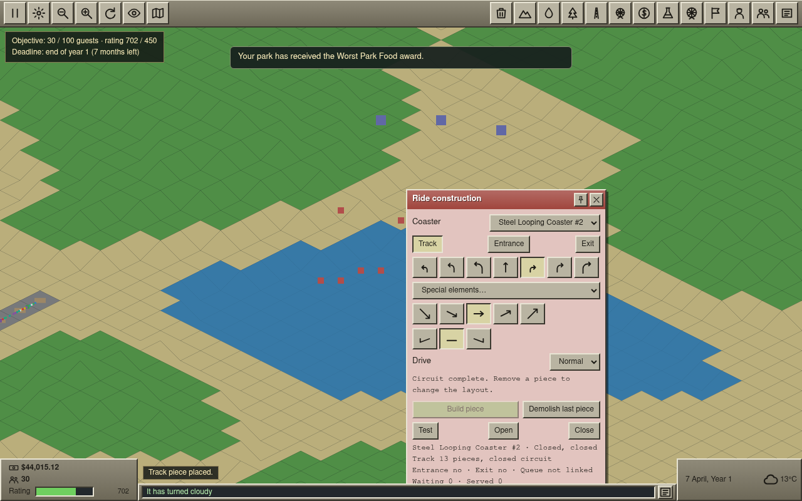                                                                                   | The RCT2 coaster construction flow adds track pieces in the park, with station, chain lift, special loop, turns and a continuous return to the station. The manual requires a station and continuous track; the public time-lapse shows a player constructing and testing a looping coaster. OpenCoaster built a 13-piece closed circuit with a loop. [Manual, pp. 53–55](https://cdn.akamai.steamstatic.com/steam/apps/285330/manuals/manual.pdf), [RCT2 looping-coaster build video](https://www.youtube.com/watch?v=luQnEOrDqUg)                                                   |
| 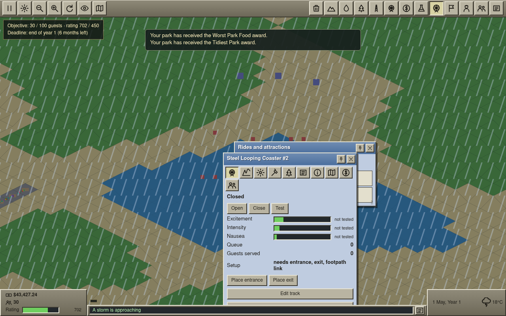                                                                            | RCT2's ride window separates view, mechanics, maintenance, statistics, finances and guest data. OpenCoaster reports “needs entrance, exit, footpath link” and keeps the ride closed until setup is complete. The ride did not reach testing or dispatch in this playthrough. [RCT2 manual, pp. 37–40](https://cdn.akamai.steamstatic.com/steam/apps/285330/manuals/manual.pdf)                                                                                                                                                                                                        |
| 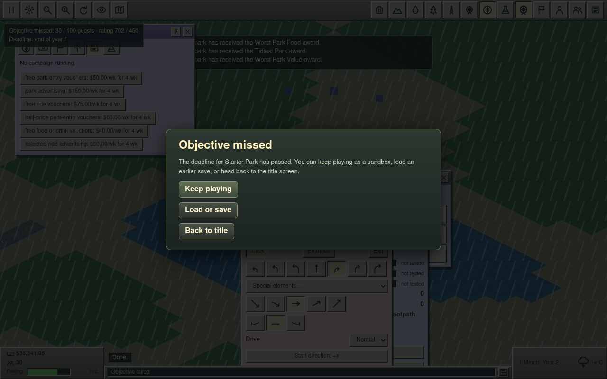                                                                                       | RCT2 evaluates scenario objectives at their deadlines and presents completion or failure. The scenario deadline was tick 131,072. Thirteen ticks later, after the HUD calendar rolled from the October Year 1 deadline to 1 March, Year 2, the build displayed “Objective missed” with 30/100 guests and rating 702/450. [RCT2 manual, scenario objectives](https://cdn.akamai.steamstatic.com/steam/apps/285330/manuals/manual.pdf)                                                                                                                                                  |
| 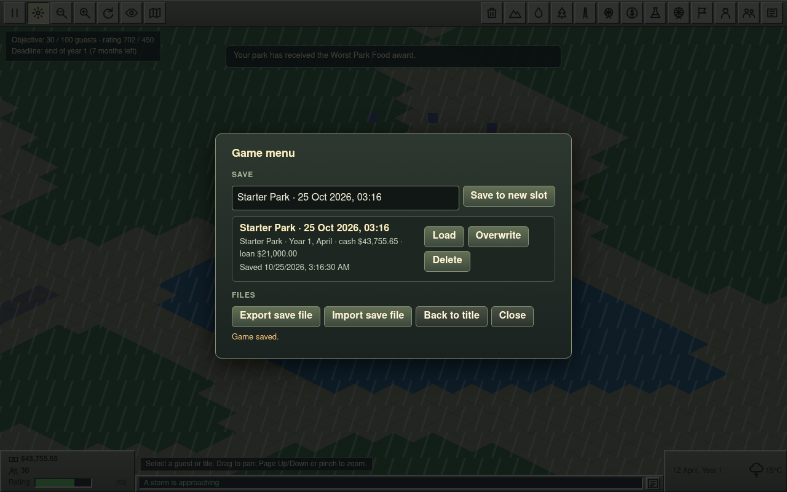 and 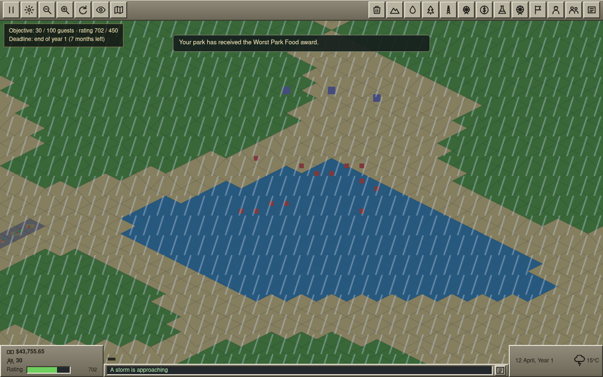                      | RCT2's Game Options/disk menu saves and loads a park. OpenCoaster saved a named Starter Park slot and loaded it; the saved date, cash and loan matched the slot summary after load. The UI is a modal save menu rather than the original disk-menu flow. [RCT2 manual, p. 17](https://cdn.akamai.steamstatic.com/steam/apps/285330/manuals/manual.pdf)                                                                                                                                                                                                                                |
| 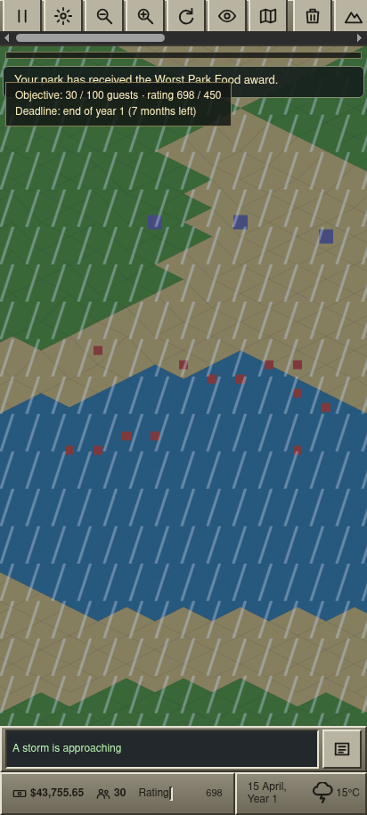 and 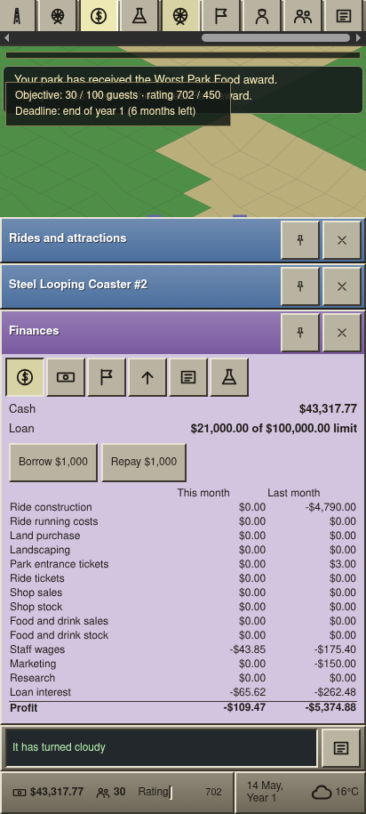 | The original RCT2 interface is desktop-oriented. OpenRCT2's Android notes say its phone interface and controls are not optimized for phones, so this is a usability comparison rather than a vanilla requirement. In OpenCoaster, 44×44 px toolbar targets and bottom-sheet windows are usable, but 20 toolbar actions span 928 CSS px; about eight are visible at once and the rest require horizontal scrolling. [OpenRCT2 Android notes](https://github.com/OpenRCT2/OpenRCT2/wiki/Android), [OpenRCT2 main interface](https://docs.openrct2.io/en/latest/playing/main_interface/) |

## Full scenario year

**Result:** the game advanced past the full Year 1 deadline (`TICKS_PER_YEAR` = 131,072) to tick 131,085 and showed “Objective missed” at 1 March, Year 2. The final HUD values were 30/100 guests and rating 702/450, so the rating threshold was met but the guest threshold was not. The scenario ran to its terminal result without a page crash. The MGR, food stall, and coaster remained closed because I did not complete their entrance/exit/path setup; this run therefore does not establish whether operating attractions would have met the guest target. The deadline result is a verified scenario outcome, not proof of an objective-evaluation defect.

## Verified observations

- The title screen, scenario selection, park HUD, finance, staff, ride construction/list/detail, marketing, and save/load surfaces all render and respond in the published build.
- One path placement was accepted. A Merry-Go-Round and Food Stall were placed. A Steel Looping Coaster built a visible 13-piece closed circuit with a loop. The coaster detail panel showed that it still needed an entrance, exit and footpath link; it remained closed and untested.
- Staff roster showed three employed after hiring a Handyman, Mechanic and Security Guard. The initial loan was $20,000; Borrow $1,000 changed it to $21,000. Weekly wages and interest later appeared in the monthly ledger.
- Finance UI contains accounts, three graph views, Marketing and Research tabs. The current marketing UI shows six campaign families, but hardcodes each button to four weeks. A park-advertising campaign started and reported $150/week for four weeks.
- A targeted free-ride-voucher button did not start a campaign: the screen remained at “No campaign running.” This is reproducible from the current UI code: `finance-window.ts` sends no target id, while `marketing.ts` rejects ride/item campaigns without one.
- A saved slot round-tripped through the in-game Load action. The slot summary preserved scenario, year/month, cash and loan. No crash or console/page error was observed during the monitored action windows.
- The scenario objective was evaluated at the Year 1 deadline tick 131,072. The miss became visible 13 ticks later, after the calendar rolled from the October Year 1 deadline to 1 March, Year 2 (30 guests, rating 702). This playthrough did not open its rides or stall, so the guest-count result is specific to this park setup.
- At the emulated Pixel 8 size, the viewport and document remain 412×915 without page-level horizontal overflow. The toolbar is its own horizontally scrolling strip, so controls remain reachable by touch scrolling. It is still a dense icon-only strip and makes finance/build actions take multiple swipes to find.

## Follow-up verification — ride access and mobile actions

The original audit above records the published build and remains a historical result. In follow-up branch `feat/ride-setup-mobile-toolbar` (PR [#55](https://github.com/tilework-tech/opencoaster/pull/55)), a headed Chromium playthrough started a new Starter Park, built paths, a Merry-Go-Round, a Food Stall, and a short Steel Looping Coaster, then opened the attractions. The coaster served 59 guests by 30 March, Year 1; the separate desktop and Pixel 8 E2E cases assert that guests ride within two in-game months (32,768 simulation ticks). The E2E also checks the 412 px Actions menu labels and 44×44 px minimum action targets.

The follow-up screenshots are OpenCoaster captures: [desktop entrance placement](../screenshots/ride-setup-desktop-entrance.png), [desktop open coaster with guests served](../screenshots/ride-setup-desktop-open.png), and [Pixel 8 Actions menu](../screenshots/ride-setup-pixel-8-actions.png). The mobile menu fixes the one-swipe discovery gap from the audit; broader RCT2 toolbar/window fidelity remains open.

## Prioritized gap table

Priority means how much the gap blocks the “plays exactly like RCT2” bar: **P0** prevents a core requested action from working or leaves a major behavior absent; **P1** is a substantial mismatch that still permits play; **P2** is a smaller presentation or calibration gap. “Verified” means observed in this audit; “documented” means identified in the current repository fidelity specification or code inventory and not independently demonstrated in the live playthrough.

| Priority / evidence                      | Gap and concrete PR-sized fix                                                                                                                                                                                                                                                                                                                                                                                                                                                                                                                              | Owning modules                                                                                   | Acceptance criteria                                                                                                                                                                                                                                                                                    |
| ---------------------------------------- | ---------------------------------------------------------------------------------------------------------------------------------------------------------------------------------------------------------------------------------------------------------------------------------------------------------------------------------------------------------------------------------------------------------------------------------------------------------------------------------------------------------------------------------------------------------- | ------------------------------------------------------------------------------------------------ | ------------------------------------------------------------------------------------------------------------------------------------------------------------------------------------------------------------------------------------------------------------------------------------------------------ |
| **P0-1 · verified**                      | Targeted marketing actions silently fail, and duration is fixed at four weeks. Add a duration selector and ride/item target selector; only enable offers with a valid target; pass the selected target id to the economy command and show rejection feedback.                                                                                                                                                                                                                                                                                              | `src/ui/windows/finance-window.ts`, `src/sim/economy/actions.ts`, `src/sim/economy/marketing.ts` | All six campaign families start. Ride/item campaigns retain an eligible target, park-wide campaigns need none, durations 1–6 weeks are selectable, campaign charges/expiry match the selected duration, and invalid choices explain why they did not start. Add UI and simulation regression coverage. |
| **P0-2 · verified from current catalog** | Base-game ride coverage is only 10 entries: four flat rides, two coasters, and four shops/facilities. The RCT2 PC manual organizes base-game choices across transport, gentle, thrill, coaster, water, and shops/stalls categories (see the ride-category sections); the [community complete rides list](https://rct.fandom.com/wiki/The_Complete_Rides_List) illustrates the wider catalog. Several core park-building categories are absent from OpenCoaster. Add catalog types in player-visible vertical slices, with availability and research rules. | `src/sim/rides/ride-types.ts`, `src/ui/windows/ride-select.ts`, `src/sim/rides/`                 | Cover each base-game category and ride type in the chosen RCT2 edition when scenario/research permits; each type has valid placement, operating lifecycle, and save/load behavior. Publish a manual-derived inventory of supported and excluded types.                                                 |
| **P1 · verified**                        | The phone toolbar shows only part of the 20 icon buttons at once. Horizontal scrolling works and targets meet 44 px, but finding Finance, rides or build tools takes repeated swipes and labels are absent. Add a compact labeled action menu or grouped quick-access controls while retaining the current touch map gestures.                                                                                                                                                                                                                             | `src/ui/toolbar.ts`, `src/ui/game-ui.ts`, `src/ui/ui.css`                                        | At 412 px width, all core actions (pause, paths, rides, finance, staff, park and save/load) are discoverable in at most one deliberate menu action; map pan/zoom and 44 px touch targets still work.                                                                                                   |
| **P1 · documented**                      | UI fidelity remains partial: RCT2 has a classic grouped toolbar and specialized windows; OpenCoaster uses its own icon toolbar, DOM windows, and simplified ride/staff details. Refresh the UI gap inventory against the current implementation and implement one complete information window per PR.                                                                                                                                                                                                                                                      | `src/ui/toolbar.ts`, `src/ui/window-manager.ts`, `src/ui/windows/`, `docs/fidelity/ui.md`        | Window-by-window acceptance is recorded; each implemented surface has a manual-derived comparison and desktop/mobile interaction coverage.                                                                                                                                                             |
| **P2 · verified**                        | The game HUD reported Canvas2D in this browser run. This is not a crash and may reflect the session browser's graphics capability; confirm intended renderer selection on supported desktop hardware before treating it as a defect.                                                                                                                                                                                                                                                                                                                       | `src/render/renderer.ts`, `src/render/webgl2-renderer.ts`                                        | On supported WebGL2 hardware the active renderer is identified correctly; fallback remains functional and emits actionable diagnostics when selected.                                                                                                                                                  |

### P0 GitHub issue status

Attempted to create **“[P0] Make targeted marketing campaigns launchable”** with the `bug` label through `gh`. The GitHub App rejected `createIssue` with `Resource not accessible by integration`; no issue was created. P0-1 and P0-2 above are the issue drafts; no issues were created. Repository integration permissions must allow issue creation before they can be filed.

## Sources

- Atari/Infogrames, [RollerCoaster Tycoon 2 manual](https://cdn.akamai.steamstatic.com/steam/apps/285330/manuals/manual.pdf) (scenario/menu pp. 10–17; interface pp. 14–23; staff pp. 41–43; finance/marketing pp. 48–51; coaster construction pp. 53–55).
- OpenRCT2, [main interface](https://docs.openrct2.io/en/latest/playing/main_interface/), [footpaths and queue lines](https://docs.openrct2.io/en/latest/playing/footpath/index.html), [shops and stalls](https://docs.openrct2.io/en/latest/playing/shops_and_stalls/), [finances](https://docs.openrct2.io/en/latest/playing/finances/), and [Android notes](https://github.com/OpenRCT2/OpenRCT2/wiki/Android).
- Public RCT2 references: [complete rides list](https://rct.fandom.com/wiki/The_Complete_Rides_List) (community wiki, used for category breadth only); footage of [Building a 10×10 Looping Coaster in RCT2](https://www.youtube.com/watch?v=luQnEOrDqUg) and an [RCT2 Looping Coaster ride overview](https://www.youtube.com/watch?v=SRO9E6_aNJw).
- Repository behavior specs: [ui.md](ui.md), [economy.md](economy.md), [rides.md](rides.md), [track.md](track.md), [world.md](world.md), and [guests.md](guests.md).
