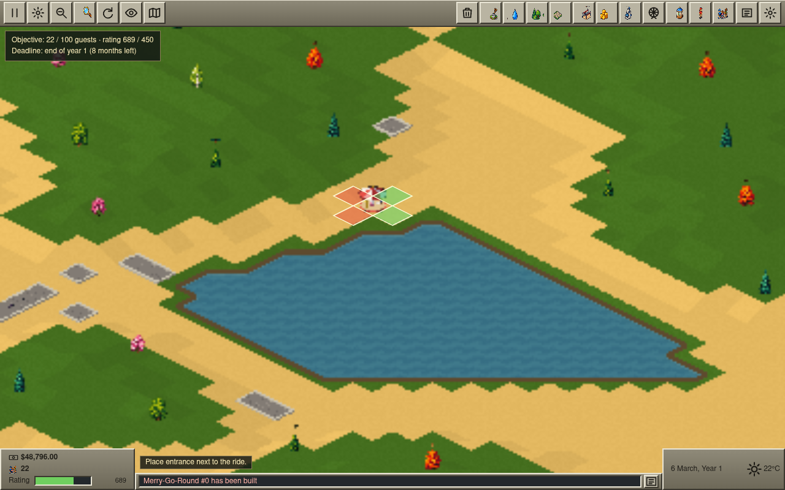
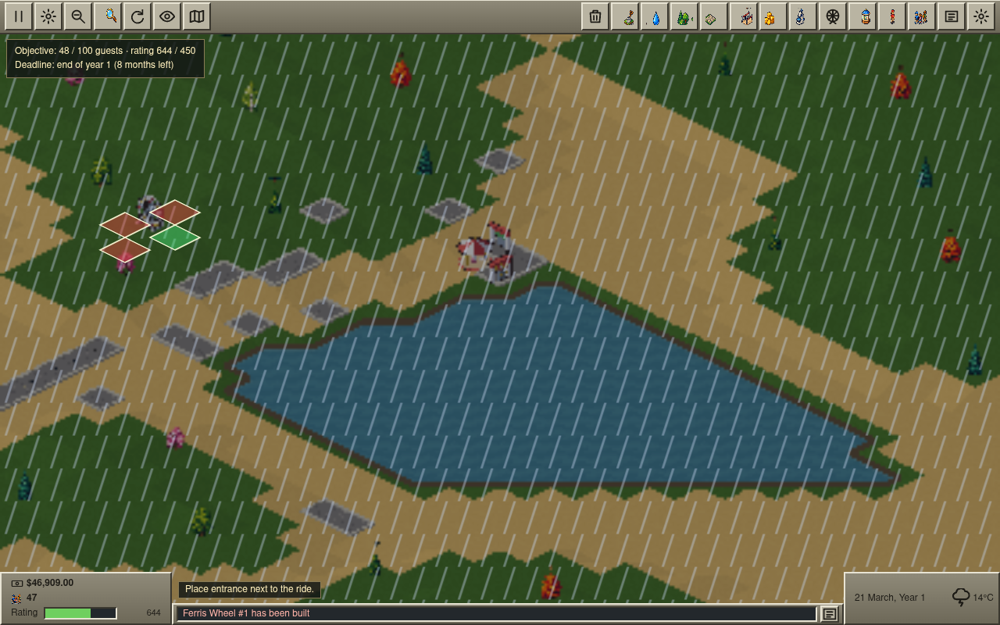
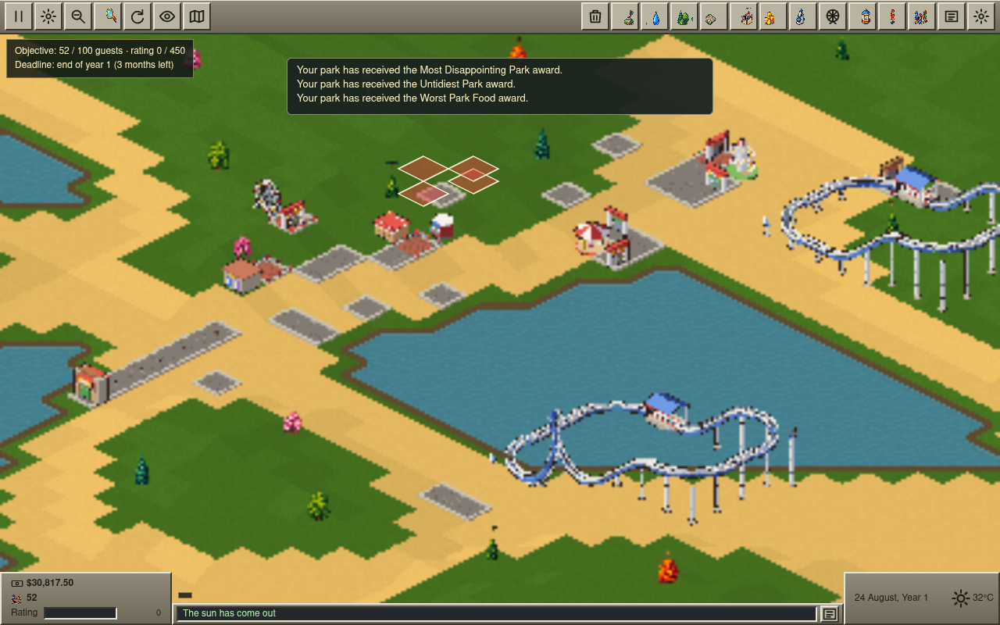
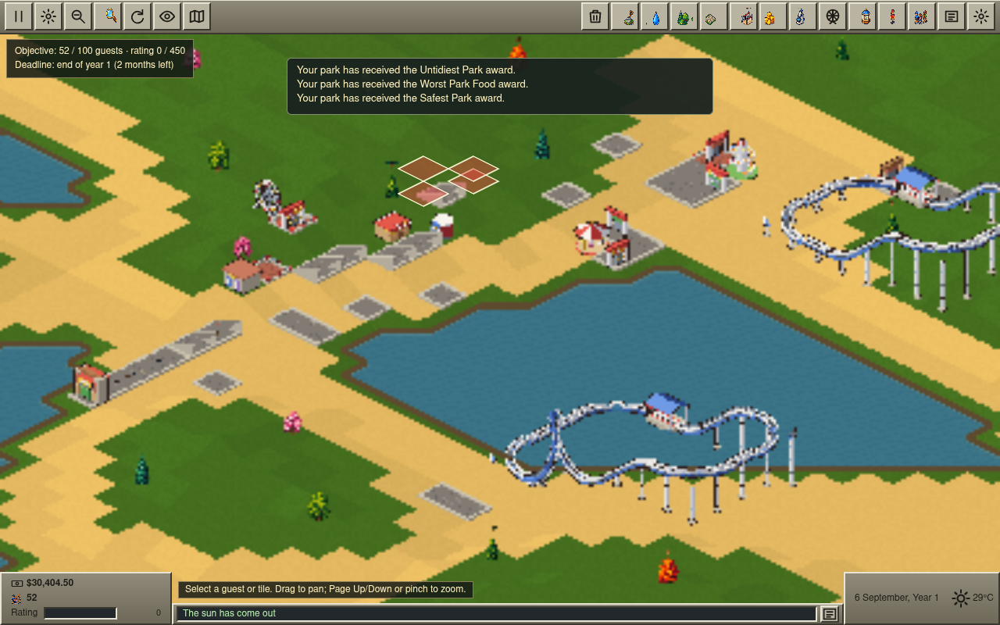
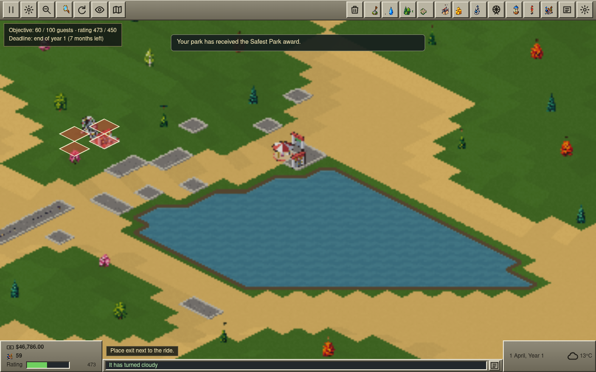
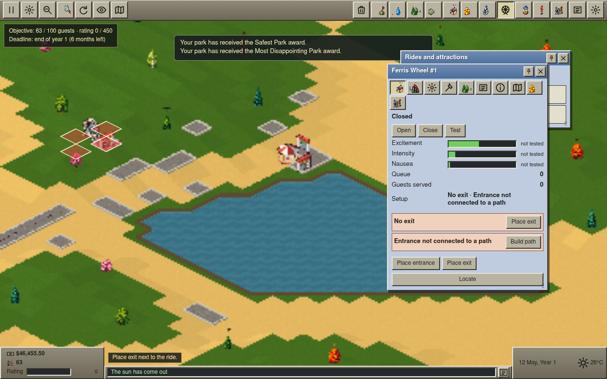
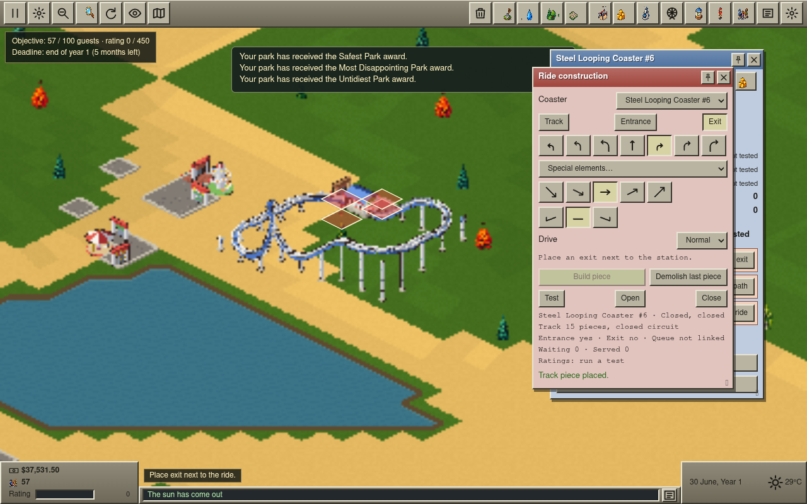
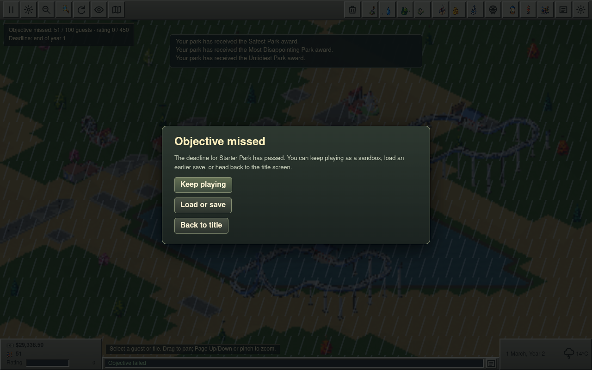

# OpenCoaster playtest — 2026-10-25

## Method and limits

- **Build:** live site https://tilework-tech.github.io/opencoaster/ (GitHub Pages `main` at the time of the run).
- **Driver:** Playwright with system Chrome, UI only (mouse, keyboard, touch). No dev hooks, no scripted saves, no sim access. Three profiles: desktop 1280×800 WebGL2 (SwiftShader), the same with `getContext('webgl2')` forced to `null` (Canvas2D fallback), and Pixel-class emulation 412×915 @2.625 with touch.
- **Played:** Starter Park end to end on desktop WebGL2 (paths, queue-less flat rides, 2 stalls, toilets, steel looping coaster with a loop built piece by piece, test, prices, staff, marketing, save → reload → load, 4× to the year-1 outcome). Bramblewood Hollow and Lantern Bay were started and inspected briefly. Canvas2D and Pixel got a start-up look plus a few interactions only; they were **not** played through.
- **Not achieved (and why):** the park never became a working park. The path network stayed broken (P0-1, P0-2), so no guest ever reached a ride and ride/shop income stayed $0 for the whole year. The looping coaster could be built and tested but never opened (P0-4). Pricing was only inspected, not tuned. Items 5–7 in the original brief were therefore exercised mechanically, not as a gameplay loop.
- **RCT2 comparison:** from the RCT2 manual and OpenRCT2 docs already cited in [the October audit](../fidelity/audit-2026-10.md), plus general RCT2 knowledge. I did **not** watch RCT2 video for this run, so "RCT2 does X" claims about look and feel are from memory of the game, not frame-by-frame comparison.
- Repro coordinates below are for desktop 1280×800, default zoom after pressing PageDown once from the opening view, unless stated. Tile coordinates come from the game's own status text. Gameplay was at 1× then 4×; the day counter ran roughly one in-game month per 20–40 real seconds at 4×, so building at 4× is hard (P1-9).
- Console: no `pageerror` and no console errors on desktop WebGL2 or Pixel. The Canvas2D profile logged one expected warning (`WebGL2 renderer failed; using the Canvas2D fallback`).
- Performance: HUD showed 15–20 fps and 1.5–2.1 ms frame cost in SwiftShader software GL with ~1,600 sprites on screen; sim 0.01 ms/tick. That fps is the software rasteriser and is not a claim about real GPUs. No dropped ticks.

## P0 — blocks a client demo

### P0-1 Art scale is about half of what the tile grid implies (flat rides, paths, guests)

A 2×2 Merry-Go-Round is a ~40 px sprite on a 128 px footprint; the Ferris Wheel is a ~20 px dark blob; guests are 3–4 px dots on a 64×32 px tile; path slabs are partial-tile. The coaster track and the stalls are close to correct scale, so rides look inconsistent next to each other. In RCT2 a Ferris Wheel dominates its footprint and guests are readable people.

- Repro: New game → Starter Park → New ride → Gentle rides → Merry-Go-Round → click any open tile (screenshot `w13-placed`). Then Ferris Wheel (screenshot `w26-ferris`). Look at the guests on the entrance path (`w65`).
- Suspected module: `src/render/world-art.ts`, `src/render/sprite-layout.ts`, `tools/art/` sprite generation (anchor/scale per sprite), `placement-art.ts` for the ghost.

### P0-2 Path placement on sloped ground silently fails; the network breaks with no feedback

With the default Footpaths settings, clicking a sloped tile shows `Path placement requested at x, y.` but nothing is built. Only after turning on **Follow terrain slope** do sloped pieces appear. Result in my run: gaps in the line from the park entrance, ~50 guests stuck on tiles (26,42)–(26,46) for the whole year, 0 ride tickets, 0 shop sales, and the objective missed. The UI never says "not connected" or "guests can't reach anything". RCT2 builds a sloped path automatically when you drag along a slope, and its entrance-to-ride connection checks are visible.

- Repro: Starter Park → Footpaths → click tiles north of the entrance strip (26,43)…(26,31). Some tiles stay bare although the status says "requested". Toggle "Follow terrain slope" and click the same tiles: sloped slabs appear (`w67`).
- Also: the sim rejects commands silently (`src/ui/docs.md`: "Map-command rejections remain silent"), and the status shows request, not result.
- Suspected modules: `src/app/tools/handlers.ts` (path tool), `src/ui/windows/tool-windows.ts` (slope toggle default), sim map command handler for path placement.

### P0-3 Ride entrance/exit placement can dead-end with no explanation

Ferris Wheel: after placing the entrance, all four exit candidates are red; clicking them does nothing; the ride is stuck at "No exit" and cannot be opened. There is no Demolish for a ride anywhere in the ride window (tabs: View, Description, Mechanics, Maintenance record, Colour and style, Music, Ride statistics, Data log, Financial data, Guest data), so a stuck ride and its money are permanent.

- Repro: Starter Park → New ride → Gentle rides → Ferris Wheel → click tile (22,36) (west of the path column) → Place entrance at tile 24,37 → Place exit: no green tile (`w27`, `w29`).
- Suspected modules: `src/app/ride-setup/index.ts` (candidate generation and validity colouring), `src/ui/windows/ride-window.ts` (no demolish control).

### P0-4 Steel Looping Coaster cannot be completed: no valid exit, so it can never open

Built Station → chain-lift climbs → turns → drops → Level → Loop left → turns, closed circuit (`Track 15 pieces, closed circuit`), tested (E 5.76 / I 5.33 / N 1.83), but exit placement showed only red diamonds, every click gave `Something is in the way.`, and Open said `Place an exit next to the station.` The same circuit shape that the e2e suite uses (`e2e/starter-ride-access.spec.ts`) also had no valid exit at my site, so validity depends on terrain around the station and the UI never says why. The only valid tile was the rear of the station, which is where the closing track enters.

- Repro: New ride → Roller Coasters → Steel Looping Coaster → click open sand near the NE of the lake (tile ≈ 35,23) → Build pieces as above → Exit mode.
- Suspected modules: `src/app/ride-setup/index.ts`, `src/sim/rides/ride-commands.ts` (station-adjacent validation), `src/ui/track-tool.ts` (`feedbackMessage`).

### P0-5 Objective deadline and date model disagree

Scenario card says `Deadline: October year 1`, the objective strip says `end of year 1 (8 months left)` on 1 March, shows `2 months left` on 20 October, and the "Objective missed" dialog only fired on **1 March, Year 2**. A client watching the clock will see the deadline pass and nothing happen for four months.

- Repro: Starter Park, 4×, watch the strip and the date through October.
- Suspected modules: `src/sim/scenario/scenario-system.ts`, `src/ui/objective.ts` (deadline text vs. evaluation tick).

PR #77 corrects the date label and evaluates the objective at the October month boundary. The production capture shows the October deadline in the strip before it is due (`assets/pr77-october-deadline-strip.png`).

## P1 — obviously unlike RCT2

1. **Starting rating is absurd and collapses.** In the original playtest, with nothing built the rating read ~700; it fell to 473 by 1 April and 0 by mid-May, with "Most Disappointing Park" and "Untidiest Park" awards. PR #77's follow-up calibration starts an empty park at 250 (150 with difficult rating), then adds up to 450 development points as attractions open; see [the balance notes](../BALANCE.md#rating) and [fidelity notes](../fidelity/economy.md#opencoaster-starting-rating-calibration). These are OpenCoaster tuning values, not claimed RCT2 constants.
2. **Guests with no path to anything.** Guests spawn into a disconnected entrance and sit there for the whole run, all "Hungry". RCT2 guests wander and complain visibly. Same modules as P0-2 plus `src/sim/guests/navigation.ts`.
3. **Every ride unlocked at start.** Ride menu lists Steel Looping Coaster, Top Spin, Enterprise etc. on day 1; category tabs only highlight the group, they do not filter. The Research tab shows the same list. RCT2 gates by research and filters by tab. Module: `src/ui/windows/ride-select.ts`.
4. **Terrain look.** WebGL2: jagged pixel-noise edges, no tile structure, no sand/grass height cues, **no land-ownership borders or "land for sale" markers** (path or ride clicks outside owned land only say "outside the park map"). Canvas2D: a different look (checker pattern, visible grid, no sand patches, water with grid lines). Modules: `src/render/ground-chunks.ts`, `src/render/terrain-geometry.ts`, `src/render/canvas2d-renderer.ts`.
5. **Windows open on top of what you are building.** Ride window, Park window, ride list and construction window stack on the right and cover the ride or coaster being built; the construction window opens with Build piece below the 800 px fold (`w36`) until dragged. RCT2 cascades windows but keeps the construction area visible. Modules: `src/ui/window-layout.ts`, `src/ui/window-manager.ts`.
6. **Pause blocks building.** While paused, `Building Spiral Slide at 33, 30…` never resolves and nothing is placed until resume. RCT2 allows building while paused. Modules: `src/worker/`, `src/app/tools`.
7. **Flat rides cannot be tested.** Test shows `This ride does not use track.`, stats stay "not tested" with partially filled bars. RCT2 test-runs every ride and fills the readings. Module: `src/ui/track-tool.ts` (`NotTrackRide`), `src/ui/windows/ride-window.ts`.
8. **Coaster over open water.** A station and a full looping circuit were accepted over the lake (`w56`). RCT2 refuses stations on water and requires supports to ground. Module: `src/sim/track/` placement validation.
9. **4× is too fast to build at.** One in-game month per ~30 s at 4×; a few minutes of clicking lost 3 months. RCT2's speeds are slower and the player usually pauses to build (see item 6). Module: `src/worker/` scheduler.
10. **Ride window feels thin.** No ride preview viewport on View, Colour and Music tabs are placeholders ("not customisable yet", "not available yet"), vehicle choice fixed. Module: `src/ui/windows/ride-window.ts`.
11. **Toilets need an entrance placement.** Toilets ask "Place entrance next to the ride." RCT2 toilets are placed facing a path in one click. Module: `src/app/ride-setup/index.ts`.
12. **Stale state across games.** After "Objective missed", starting another scenario shows `Objective failed` in the status ticker and the HUD. Camera starts in empty terrain with the entrance off-screen (Lantern Bay shows desert and a sliver of path, `w75`). Modules: `src/ui/news.ts`, `src/app/bootstrap`.
13. **Dev control in the shipped UI.** The original build exposed Options → Development → `Guests +1,000`. PR #77 removes that development control from production; `assets/pr77-production-options.png` captures the production Options window.

## P2 — polish

- Title screen is a plain bevelled menu with no logo art; the Game menu and slot cards use a different dark rounded style from the bevelled windows (`w68`).
- Date box wraps (`10 September, Year 1` on two lines at 1280 px) and clips at Pixel width.
- Coaster cost line shows raw piece ids (`verticalLoopRight: $90.00`, `smallRight: $21.00`); "No piece fits those controls here." gives no reason (loop after a downslope needs a level piece first).
- "Edit track" opens construction in Entrance mode so Build piece is disabled until you click Track; nothing says why.
- Open and Close buttons have no pressed state, so a ride's state is only shown by the line above. Excitement/Intensity/Nausea bars show partial fill while "not tested".
- Rain and storm overlay: dense diagonal streaks over the whole screen; alternates every few seconds at 4×.
- Camera position is not saved; after Load the view resets to the opening view and a stale "Welcome to your park" ticker line returns.
- Setup overlay (red/green diamonds) lingers after "Ride setup complete".
- Scenario preview art is generic and does not match the actual map; every card has its own Start button plus a duplicate in the preview.
- Pixel: with one build sheet open the map viewport is about 40% of the screen; the park opens in empty terrain; toolbar and sheets work and targets are 52 px tall (`p9303-ride`). Taps and drag-pan worked; construction was not attempted by touch.
- Toolbar buttons toggle their windows, so a second click to "make sure it is open" closes it.

## What worked

Save to a slot, reload the page, Load: ride list, cash, date and staff restored. Staff hiring, marketing campaign launch (park advertising, 4 weeks) and finance tabs worked. The coaster track, supports and loop art are the best in the game and read as RCT2-like. Stalls place and open in one click next to a path. Drag-pan, zoom ladder and `Tab` map worked. No console errors on WebGL2 or Pixel.

## Screenshots

| File                                                           | What                                                   |
| -------------------------------------------------------------- | ------------------------------------------------------ |
| `assets/w03-start.png`                                         | Starter Park opening view, desktop WebGL2              |
| `assets/w21-pathnet.png`                                       | Path slabs and ride sprites at default zoom            |
| `assets/w36-coaster.png`                                       | Construction window opens below the fold               |
| `assets/w42-track5.png`                                        | Coaster mid-build with ghost                           |
| `assets/w49-pan.png`                                           | Coaster station and entrance overlay                   |
| `assets/w61-staff.png`, `assets/w62-marketing.png`             | Staff and marketing                                    |
| `assets/w24-options.png`                                       | Options with Development button                        |
| `assets/pr77-production-options.png`                           | Production Options window; no development controls     |
| `assets/pr77-october-deadline-strip.png`                       | Production HUD showing the October deadline this month |
| `assets/w68-save.png`                                          | Save menu                                              |
| `assets/w74-bramble-start.png`, `assets/w75-lantern-start.png` | Other scenarios, stale "Objective failed"              |
| `assets/p9302-start.png`                                       | Canvas2D fallback look                                 |
| `assets/p9303-ride.png`                                        | Pixel-class layout with build sheet                    |
