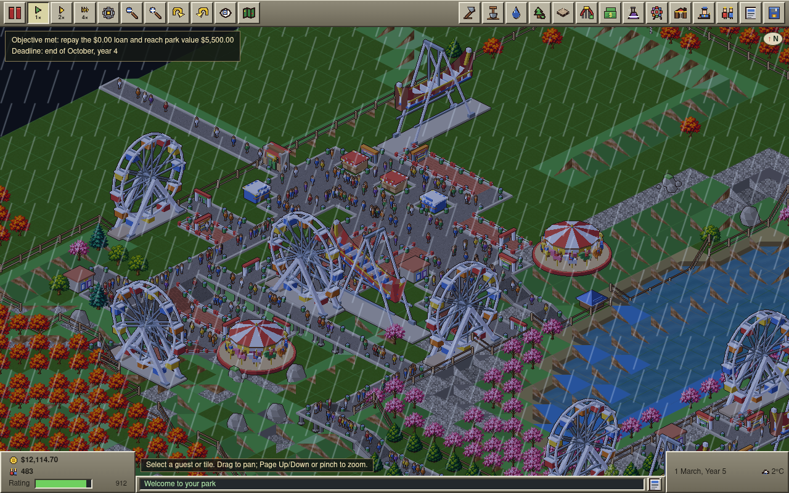
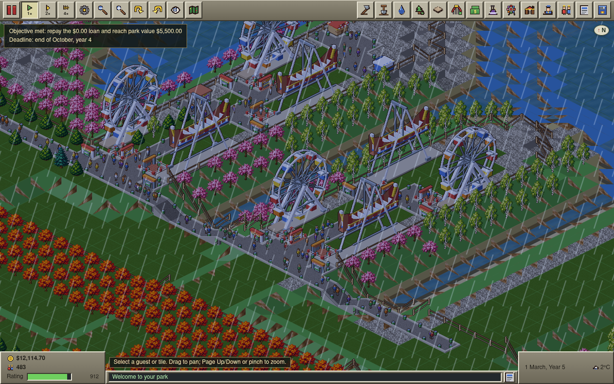
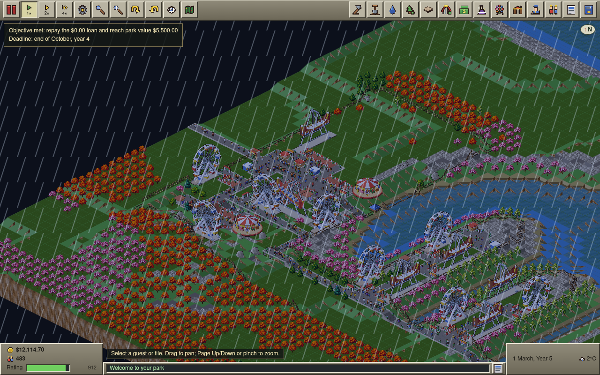
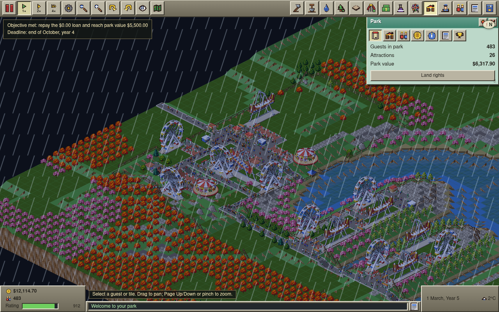
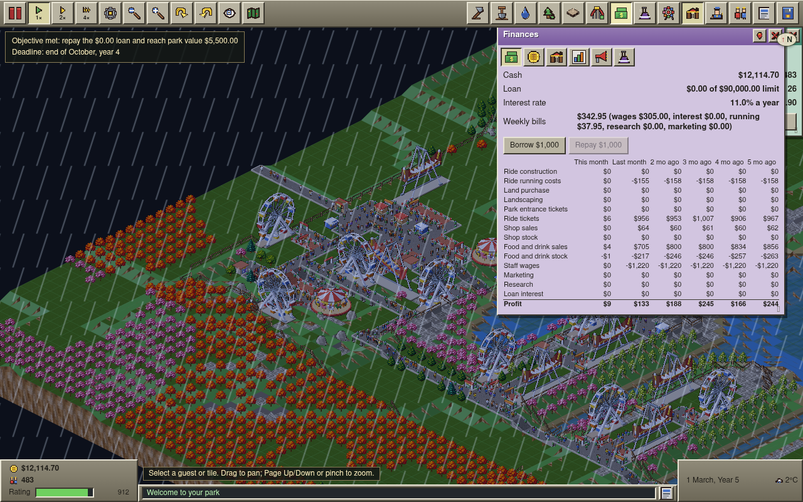
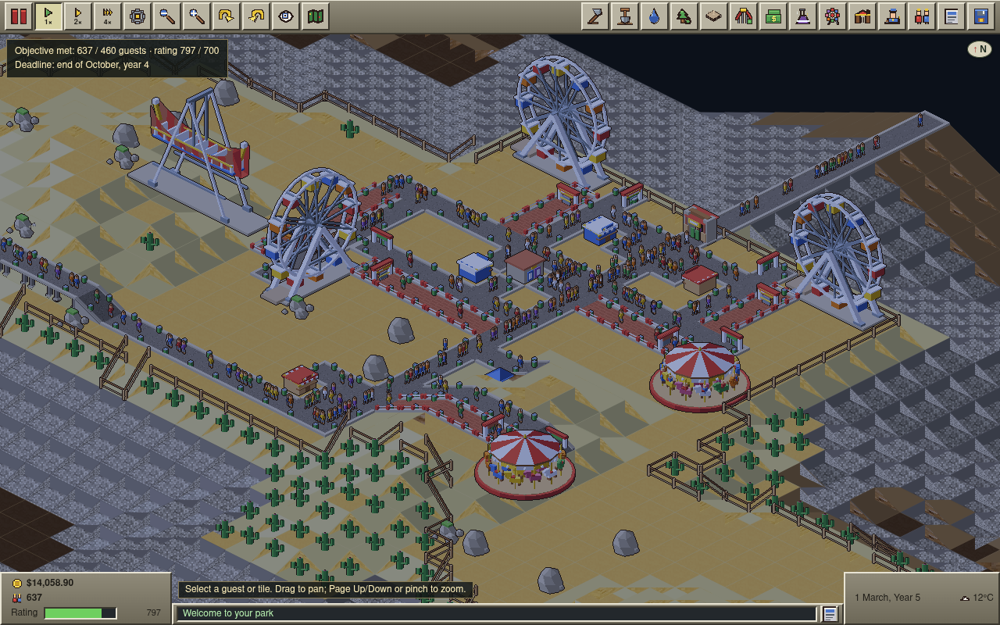
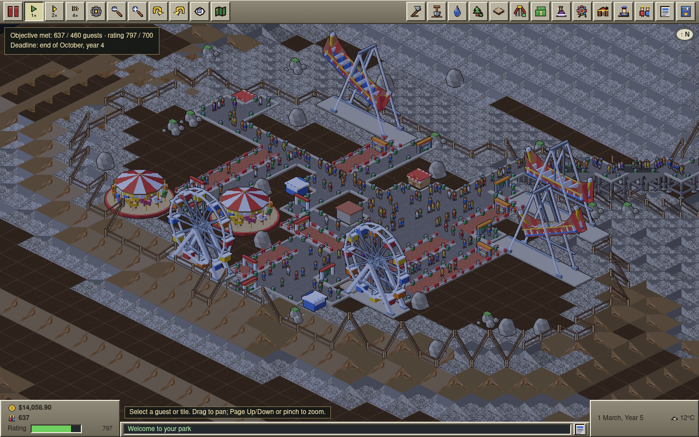
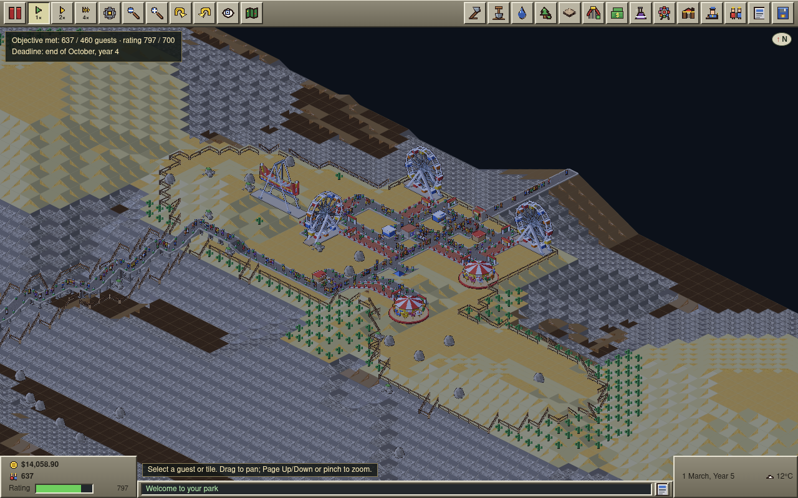
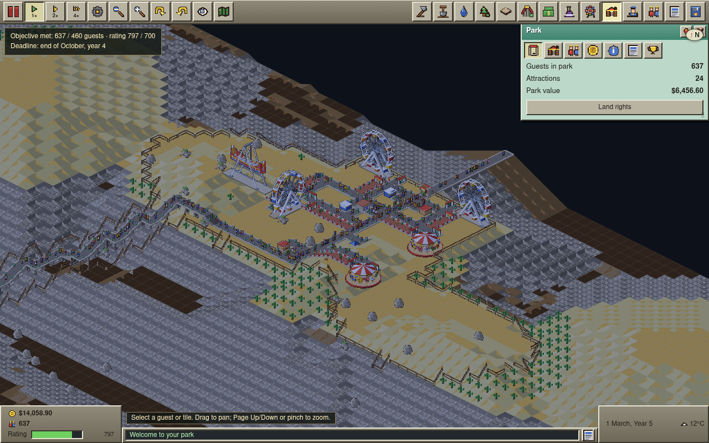
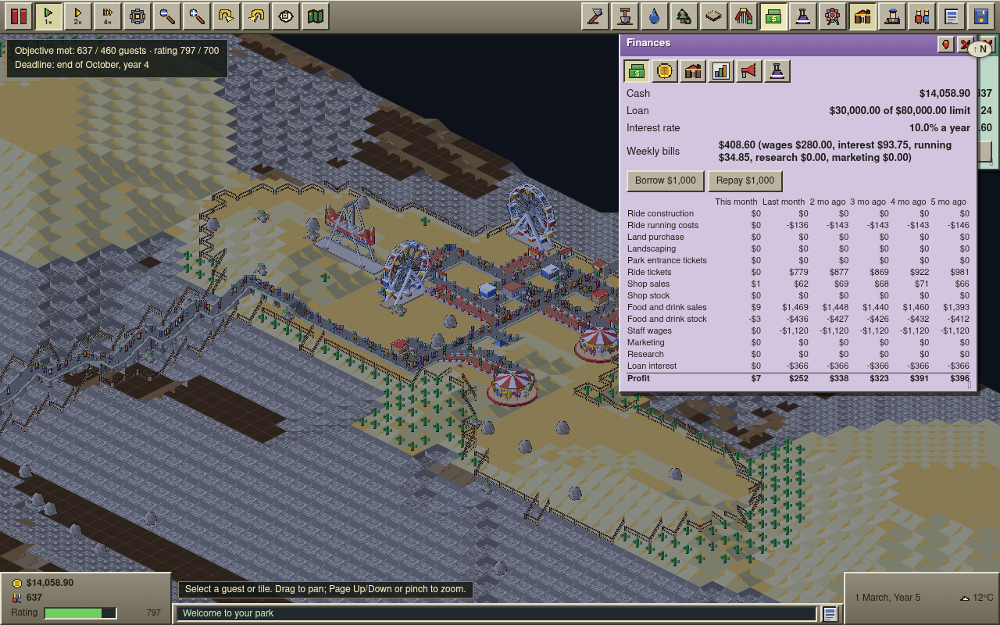

# Tidewater Docks and Thunderhead Mesa won legally: proof (PR #191)

Branch `scenario-remix-tidewater-thunderhead-wins`. Both parks are played to their deadline on the
map a new game generates (the scenario's own seed). Each run starts from the scenario's own cash,
loan and research, uses only ordinary player commands, and spends real money. Nothing is forced:
no cash, guests, ratings or objective state are set, and there are no dev-only world edits.

## Reproduce

```sh
# The wins (each test plays a park to its deadline and asserts Won):
pnpm exec vitest run bench/hard-park-wins
# Write the won parks for the browser, then capture them (Canvas2D):
HARD_PROOF_SAVES=$PWD/.local/proof-saves pnpm exec vitest run bench/hard-park-wins
HARD_PROOF_DIR=$PWD/.local/proof HARD_PROOF_SAVES=$PWD/.local/proof-saves CANVAS2D=1 \
  pnpm exec playwright test -c playwright.e2e.config.ts e2e/hard-parks-proof.spec.ts -g "won park"
# Validation seeds (scripted sweep):
pnpm balance -- --scenario tidewater-docks --seeds 3
pnpm balance -- --scenario thunderhead-mesa --seeds 3
```

The strategies are `STRATEGIES['tidewater-docks']` and `STRATEGIES['thunderhead-mesa']` in
`bench/strategy/strategies.ts`, with plans in `bench/strategy/plans/`.

## Results

| Park and objective | New-game seed, real research | Seeds 1–3 | Before (PR #190) |
| --- | --- | --- | --- |
| Tidewater Docks: repay the $6,000 loan and reach park value $5,500 by the end of year 4 | seed 2202: **won**. Value $6,389.10, loan $0 (repaid by month 4), rating 912, 483 guests, cash $12,485.60 | 1/3. Seed 2 won ($7,110); seeds 1 and 3 ended at $5,411 and $5,042 | 0/12 |
| Thunderhead Mesa: 460 guests and rating 700 by the end of year 4 | seed 3101: **won**. 637 guests, rating 818, cash $14,493.65 | 3/3 (579–662 guests, rating 732–818) | 0/12 |

`won.ocsave` files are the parks at their deadline. Any build of the PR can import them.

## Why the parks were losing

- **The script, mostly.** The #190 plans put most flat rides 2 tiles from their spine, which leaves
  no queue tiles. Each ride's queue capacity was then 4, and guests still walking to it count
  against that. Four walkers crossing the harbour filled every ride:
  - 399 of 515 Tidewater guests had no ride to choose.
  - Guests spent about $4 a month each.
  - That could not pay for 18 staff and $200 a month of research.
- **Thunderhead layout faults.**
  - An overlapping placement boxed in a Ferris wheel exit, so it could never be repaired.
  - A patrol edge stranded the cliff-trail handyman.
  - The 35-tile trail had no bins, so litter stayed at 100 and the rating fell to 0.
- **Three staff bugs, fixed in the simulation with regression tests:**
  - Idle staff could freeze for good after choosing a queue tile to wander to.
  - All mechanics chased the same breakdown as one pack.
  - New hires could be dropped onto a cut-off stretch of path. On one seed this stranded both
    mechanics, and every ride stayed broken.

No scenario terrain, ownership, rule, goal or deadline was changed.

## Screenshots

These come from the dev build in headless Chromium, with the saves above imported and the game
paused at the deadline. Canvas2D is used because importing large built parks crashes headless
SwiftShader WebGL2 in this sandbox (the same as on `main`; see the PR #190 proof).

The browser recalculates the park rating after loading. Thunderhead's HUD therefore shows 797,
while the simulation recorded 818 at the deadline. Both clear the 700 target, and the objective
line reads "Objective met".

The Tidewater objective line reads "repay the $0.00 loan". The existing UI prints the loan as it
stands now, which is $0 after repayment.

### Tidewater Docks

West quay, by the gate:



Finger piers, reached along the south quay:



Whole park:



Park window: guests, attractions and park value, with the objective met:



Finances: loan repaid, research off:



### Thunderhead Mesa

Mesa top, by the gate:



West shelf, below the cliff trail:



Mesa and cliff trail:



Park window:



Finances: marketing $0, as the scenario bans it; research off:


